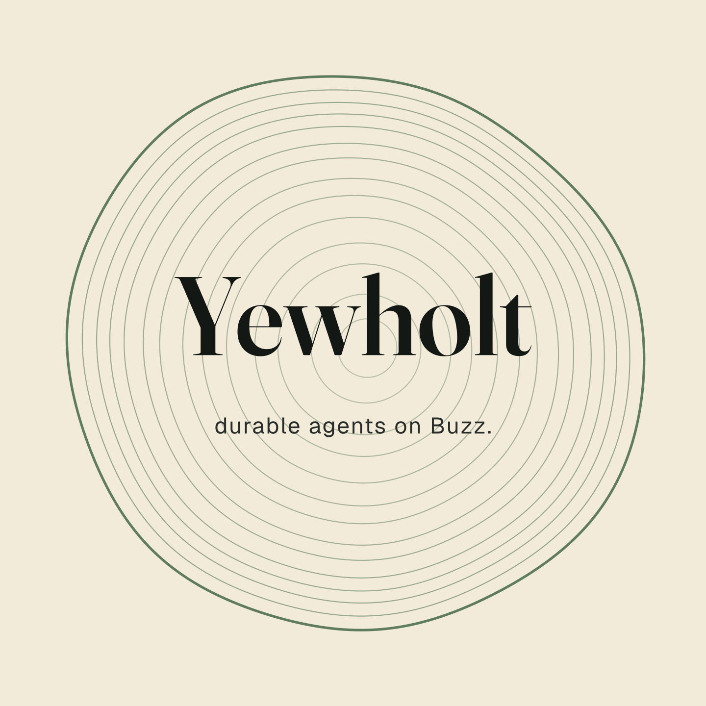

<p align="center">
  <picture>
    <source media="(prefers-color-scheme: dark)" srcset="docs/assets/yewholt-arvore-b-dark.svg">
    <source media="(prefers-color-scheme: light)" srcset="docs/assets/yewholt-arvore-b-light.svg">
    
  </picture>
</p>

# Yewholt

**Pi is the engine. Yewholt is a wrapper around [Pi](https://pi.dev) that adds
durable agents and the connection to [Buzz](https://github.com/block/buzz).**

Yewholt does not have its own agent loop, TUI or model layer. `yh` runs Pi, and
every agent Yewholt hosts is a Pi session. What Yewholt adds is the part Pi
does not do on its own: keeping agents alive across restarts and putting them
in a Buzz community, with relays, keys and pairing handled for you.

[O que é o Yewholt? / What is Yewholt?](ABOUT.md)

## Architecture

```text
Buzz desktop (Mac) + Yewholt plugin ──┐
                                      ├──► existing Buzz relay (unmodified)
yh daemon (VM or Mac) ────────────────┘
   └─ one Pi SDK session per agent · durable state in SQLite · Pi JSONL history
```

- **`yh`** is Pi: it calls Pi's own `main()` and uses the same `~/.pi/agent`
  (logins, models, packages, skills, MCP). See [Harness](#harness).
- **Daemon** (`yh start`) runs the agents on a Linux VM or a Mac. Each agent is
  a Pi coding-agent session with its own Nostr key. State lives in a
  [pi-durable](https://www.npmjs.com/package/@earendil-works/pi-durable) SQLite
  store; on restart it cancels unfinished work instead of replaying it.
- **Buzz layer.** The daemon is an ordinary client of an existing relay (it
  connects outward, NIP-42). The Yewholt plugin in Buzz desktop creates agents
  and talks to daemons with encrypted messages over the same relay, so no SSH
  or inbound port is needed. Yewholt never installs or runs the relay.

## Setup

You need Buzz desktop on a Mac, membership in a Buzz community, and one
community invite per new VM (**Settings → Community admin → Membership →
Invite**). Node.js 22.19 or newer on every machine.

1. **On the Mac**, install the CLI and the Buzz plugin:

   ```sh
   git clone https://github.com/forge-z/yewholt ~/yewholt && cd ~/yewholt
   npm ci && npm run build && npm link
   yh provider install
   ```

   In Buzz, open **Settings → Plugins → Manage plugins → Add → Browse**, pick
   the printed plugin folder and approve `yewholt-buzz-bridge`. The Mac's
   Yewholt provider must already be a member of the community. If this is
   its first setup, have the relay admin admit the provider public key printed
   by `yh provider install`. Don't use a VM's invite for the Mac.

2. **On each VM**, give your coding agent [the install skill](skills/install/SKILL.md).
   It installs the CLI and runs `yh join --daemon` using an invite from a
   secure secret field. If your agent has no such field, follow the skill's
   [manual steps](skills/install/SKILL.md#1-open-the-vm-and-check-prerequisites):
   open a private VM terminal, install `yh` if needed, then run `yh join --daemon`
   and paste the invite at the prompt, never in chat. The command joins and
   starts the daemon and opens a pairing offer for 24 hours. If the VM has
   no [models](#models), run `yh` and use Pi's `/login` on the VM before
   continuing.

3. **In Buzz**, as the community operator, create an agent with **Harness →
   Remote → Yewholt**. Buzz discovers the new VM by its daemon public key;
   pick it and a model. That first agent pairs your Mac with the VM. No second
   invite, no key to copy, no `yh pair add`.

   Buzz hides targets no longer admitted to the community relay. It keeps
   configured targets visible if the relay's member list is unavailable. To
   remove a saved target, verify its daemon public key in `yh targets list`,
   then run `yh targets remove <id> --daemon <pubkey>`. The public key check
   prevents removing a replacement machine with the same hostname by mistake.

   If operator discovery is unavailable (the VM prints
   `operator discovery is unavailable, so pair manually`), use `yh pair add` and
   `yh targets add` from
   [Manual setup without an invite](#manual-setup-without-an-invite) instead
   of pasting the VM's invite on the Mac. The VM is already joined, so skip
   `yh install`; the VM's output includes its daemon public key (also shown
   by `yh admin keys`).

To use only the coding CLI, step 1 up to `npm link` is enough; run `yh`.

### Onboarding smoke test

Every pull request runs the onboarding flow on a disposable Linux runner with a
real, local Buzz relay. The test mints a single-use invite, pipes it into
`yh join --daemon`, and drives the Buzz plugin's bridge to discover the daemon,
list its Pi models, and create an agent. It checks that Buzz stores the agent's
profile and that the daemon reports it active with the selected model. The test
does not run the Buzz GUI or call a model API; no credentials are required.

To run locally on Linux with Node.js 24, Docker Compose and OpenSSL:

```sh
npm ci
npm run build
node --test test/e2e/onboarding.test.mjs
```

The relay binds to loopback only. Set `YEWHOLT_E2E_PORT` if port 3443 is in use.

## Models

A daemon's model catalog is whatever Pi sees on that machine, as the daemon's
Unix user. Logins on the Mac do not carry over to a VM.

- **Pi logins:** run `yh` on the daemon host and use `/login` (API keys and
  supported subscriptions, e.g. `openai-codex` for ChatGPT/Codex).
- **API keys in the environment:** add a line such as `DEEPSEEK_API_KEY=...`
  to the daemon's `~/.yewholt/.env` (mode `0600`). [`.env.example`](.env.example)
  and [Built-in providers](#built-in-providers) list every
  built-in provider and variable.
- **Pi packages:** providers registered by Pi packages installed as the daemon
  user (`yh code install <source>`) are in the catalog too. For example,
  `yh code install npm:pi-claude-code` adds `claude-code/*` models that use the host's
  `claude` CLI login (`claude auth login`), not an Anthropic API key.

The built-in `anthropic` provider accepts API keys only; Claude subscription
OAuth tokens are refused there. After logging in, updating an API key or
installing a Pi package, reopen the model picker to refresh it; no daemon
restart is needed. `YEWHOLT_MODEL=provider/modelId` sets the **Daemon default**
model when the daemon starts.

## Updating

```sh
yh update
```

Run it on the Mac and on each daemon host. It updates the checkout of the
running CLI: `git pull --ff-only` in a Git checkout, otherwise it downloads the
latest `main` tarball from GitHub (no Git or GitHub login needed). It then
rebuilds, refreshes the Buzz bridge launcher if installed, and restarts a
running daemon. `yh update --archive <file.tar>` uses a local tarball instead.

The enabled Buzz plugin checks Yewholt's GitHub `main` at startup and about
once an hour. It builds updates in a separate runtime cache and switches the
bridge only after a successful build and startup check. If offline or an update
fails, it keeps using the working runtime. This does not update the CLI checkout,
restart the daemon, or change targets, pairings or keys. Buzz loads updated UI
the next time it starts, without a plugin **Update** click. Keep the plugin's
existing process approval: the bridge and UI run code from Yewholt's `main`.

Existing Buzz installs need to move to the stable plugin once: run `yh update`
on the Mac, then use **Settings → Plugins → Manage plugins → Yewholt → Update**.
After this one-time migration, subsequent bridge and UI updates do not require
`yh provider install` or the **Update** button.

## Harness

```sh
cd ~/src/some-project
yh                            # Pi on this directory
yh code -p "summarise this repo"
yh code --model openai/gpt-5
yh code --help                # every Pi flag
```

`yh` (alias `yewholt`) with no arguments opens Pi in the current directory.
`yh code [args...]` passes every argument to Pi unchanged, so any Pi flag or
subcommand works (`yh code install <source>`, `yh code --version`). Anything
installed with `pi install` is available in `yh`, and the other way round.

Yewholt adds two defaults: it loads `$YEWHOLT_HOME/.env` (default
`~/.yewholt/.env`) before Pi starts, without overriding variables already set
in the shell, and passes `--model $YEWHOLT_MODEL` when that is set and no
`--model` is given.

## Agents in Buzz

- **Talking to agents.** In a channel, `@mention` the agent. In a DM it answers
  only its owner by default. An agent answers in
  every channel it is a member of; adding or removing it in Buzz is the
  approval.
- **Model.** Open the agent in Buzz, select **Model**, choose from the
  daemon's catalog and **Save model**. History, workspace and permissions stay.
- **Stop.** The owner sends exactly `!shutdown` to the agent. Deleting the
  agent in Buzz retires it on the daemon.
- **History.** Each agent's conversation is a Pi session under
  `~/.pi/agent/sessions/yewholt-<id>/`. As the daemon user, run `yh` and
  `/resume` (all projects) and search for the agent's name.
- **Status.** `yh status` and `yh agents list` on the daemon host show each
  agent's state.

Chat works without any extra setup. Running code is opt-in, see
[Coding agents](#coding-agents).

## Reference

### Commands

| Command | Use |
|---|---|
| `yh join [--daemon \| --local] [--ssh <host> ...]` | Join a Buzz community with an invite (prompted or on stdin) |
| `yh start`, `yh stop`, `yh status` | Manage the daemon (never the relay) |
| `yh update [--archive <tar>]` | Update the checkout, bridge and running daemon |
| `yh provider install` | Install or refresh the Buzz bridge on the Mac |
| `yh targets list`, `yh targets doctor [id]` | List targets; check relay, auth, pairing and model catalog |
| `yh agents list`, `yh admin keys` | Hosted agents; this daemon's public key |
| `yh install --relay <url> --relay-pubkey <hex>` | Manual daemon setup without an invite |
| `yh pair ...`, `yh targets add ...`, `yh relay ...` | Manual pairing, targets and extra relays |

`yh help` lists every command and flag.

### Joining from the Mac

`yh join` on the Mac joins the Mac's provider, a Mac daemon (`--local`) and VMs
it reaches over SSH (`--ssh <alias>`, repeatable; `yh` must already be
installed on them). Each identity not yet in the community uses one invite
use; already admitted identities don't, so a single-use invite works for one
new identity. SSH runs with `BatchMode=yes` and the invite only goes over
stdin. Successful SSH hosts are remembered for later joins.

If the community has a join policy, `yh join` prints links to its terms and
asks for consent; non-interactive runs need `--accept-policy` (and
`--confirm-age` when required) after the user has accepted. Invites can be an
HTTPS invite page or a `buzz://join` link; treat them as secrets.

At the end, `join` checks each daemon's model catalog and prints how to log in
if it is empty.

### Manual setup without an invite

```sh
yh install --relay wss://relay.example --relay-pubkey <relay signing key>
yh admin keys                                   # daemon key for the relay admin
yh pair add <provider pubkey> --label "My Mac"  # on the daemon
yh targets add my-vm --relay wss://relay.example --daemon <daemon pubkey>   # on the Mac
```

The relay signing key is the relay's public key (NIP-11 `self`), never a
private key. Both the daemon and the Mac provider (`yh pair` prints its key)
must be admitted as relay members. Admission does not grant deploy rights;
only providers listed by `yh pair` can create agents on a daemon.

### Mac daemon

`yh join --local` sets up a daemon on the Mac and the `mac` target. On macOS,
`yh start` installs a per-user LaunchAgent that starts it at login; the Mac
must stay awake for its agents to answer. On Linux, `yh start` detaches the
daemon; use the host's service manager to run `yh daemon` at boot, or run
`yh start` again after a reboot.

### Coding agents

An agent with the `code` permission gets Pi's read, write, edit and an
isolated bash tool in its own workspace. This needs a dedicated Unix account:

- Linux: `sudo scripts/setup-bot-user.sh`
- macOS: `sudo env PATH="$PATH" scripts/setup-bot-user-macos.sh`

The scripts create the `yewholt-bot` user and `yewholt-ws` group and the
workspace root (`YEWHOLT_WORKSPACES`), outside the daemon's HOME. Shell
commands run as that user with a clean environment; file tools refuse the
daemon's state and Pi's `auth.json`. Until isolation passes its startup check,
chat keeps working and only the coding tools refuse to run, with the reason
in the reply and in `yh status`. All coding agents share one bot user and have
network access; this is account isolation, not a sandbox.

Everything inside the workspace runs without asking. Recursive deletes,
`git push`, a download piped into a shell, `sudo`/`su`/`doas`, commands that
touch the daemon's state, and writes outside the workspace wait for approval
in the chat (classifier: `src/danger.ts`). The owner (or a key in
`YEWHOLT_ADMINS`) replies `aprovo` or `rejeito`. Approvals and unfinished turns
are cancelled on restart, never replayed.

MCP servers, Pi packages and extensions configured for the daemon user run
with the daemon's permissions. Install only ones you trust. Project-level Pi
files inside a workspace are never loaded.

### Sleeping VMs

On a VM that pauses when idle and resumes on an HTTP request, set in the
daemon's `.env`:

```text
YEWHOLT_WAKE_URL=https://my-vm.example/
YEWHOLT_WAKE_PORT=8787
```

After `YEWHOLT_IDLE_MINUTES` (default 10) without work, the daemon goes
offline and disconnects so the VM can pause. The daemon announces its wake URL
on the relay. If a Buzz request such as listing models or deploying an agent
times out, the bridge looks up the daemon's signed announcement, calls the URL,
and retries. This works for targets added through join or discovery, without
manually setting a wake hook. If the target has a separate hook, the bridge
also runs it: starting a VM alone does not wake an already-running idle daemon.

Another always-on Yewholt daemon in the same community (a "watcher") sees new
messages for offline agents and calls the wake URL. A watcher can run as a
container:

```sh
docker run -d --name yewholt-watcher --restart unless-stopped \
  -v yewholt-data:/data -e YEWHOLT_RELAY_URL=wss://relay.example \
  -e YEWHOLT_NAME="Yewholt watcher" ghcr.io/forge-z/yewholt:main
```

Have the relay admin admit the key from `docker exec yewholt-watcher yh admin keys`.
To also wake on DMs and private channels, set `YEWHOLT_WATCHER_PUBKEY` on the
sleeping daemon; it then hands each agent's signing key to that watcher, so
only use a watcher you trust.

### State and keys

| Path | Contents |
|---|---|
| `~/.yewholt/` (`YEWHOLT_HOME`) | Daemon config, `secrets/owner.key`, `.env`, `state/` (SQLite, pairings, agents) |
| `~/.config/yewholt/` | Mac provider: targets, bridge state, Buzz plugin folder |
| `~/.pi/agent/` | Pi logins, models, packages and agent histories |

The Mac provider keeps its key in the macOS Keychain (service
`yewholt-provider`), or in a mode-`0600` file where Keychain is unavailable.
Back up `secrets/` and the Pi agent directory together; Buzz keys cannot be
rotated, so a lost key means a new identity. In Buzz's **Members** list,
Yewholt identities appear as `Yewholt · daemon (<host>)` and
`Yewholt · provider do Mac (<host>)`; removing one cuts that machine off.

### Built-in providers

API keys go in the daemon's `~/.yewholt/.env`. Package providers such as
`claude-code` are not listed here; they come from installed Pi packages.

| Provider | Env | Notes |
|---|---|---|
| `amazon-bedrock` | `AWS_BEARER_TOKEN_BEDROCK`, or `AWS_PROFILE`, or `AWS_ACCESS_KEY_ID` + `AWS_SECRET_ACCESS_KEY`, or `AWS_CONTAINER_CREDENTIALS_RELATIVE_URI`, or `AWS_CONTAINER_CREDENTIALS_FULL_URI`, or `AWS_WEB_IDENTITY_TOKEN_FILE` | Any one source |
| `ant-ling` | `ANT_LING_API_KEY` | |
| `anthropic` | `ANTHROPIC_API_KEY` | API key only. A value containing `sk-ant-oat` is ignored. `ANTHROPIC_OAUTH_TOKEN` is not read |
| `azure` | `AZURE_OPENAI_API_KEY` | |
| `baseten` | `BASETEN_API_KEY` | |
| `cerebras` | `CEREBRAS_API_KEY` | |
| `cloudflare-ai-gateway` | `CLOUDFLARE_API_KEY`, `CLOUDFLARE_ACCOUNT_ID`, `CLOUDFLARE_GATEWAY_ID` | All three |
| `cloudflare-workers-ai` | `CLOUDFLARE_API_KEY`, `CLOUDFLARE_ACCOUNT_ID` | Both |
| `deepseek` | `DEEPSEEK_API_KEY` | |
| `fireworks` | `FIREWORKS_API_KEY` | |
| `github-copilot` | `COPILOT_GITHUB_TOKEN` | |
| `google` | `GEMINI_API_KEY` | `GOOGLE_API_KEY` is not the Gemini key |
| `google-vertex` | `GOOGLE_CLOUD_API_KEY`, or `GOOGLE_APPLICATION_CREDENTIALS` + `GOOGLE_CLOUD_PROJECT` (or `GCLOUD_PROJECT`) + `GOOGLE_CLOUD_LOCATION` | The credentials path must exist |
| `groq` | `GROQ_API_KEY` | |
| `huggingface` | `HF_TOKEN` | |
| `kimi-coding` | `KIMI_API_KEY` | |
| `meta` | `META_API_KEY` | |
| `minimax` | `MINIMAX_API_KEY` | |
| `minimax-cn` | `MINIMAX_CN_API_KEY` | |
| `mistral` | `MISTRAL_API_KEY` | |
| `moonshotai`, `moonshotai-cn` | `MOONSHOT_API_KEY` | Shared |
| `nvidia` | `NVIDIA_API_KEY` | |
| `openai` | `OPENAI_API_KEY` | |
| `openrouter` | `OPENROUTER_API_KEY` | |
| `qwen-token-plan` | `QWEN_TOKEN_PLAN_TEAM_API_KEY` or `QWEN_TOKEN_PLAN_API_KEY` | Either |
| `qwen-token-plan-cn` | `QWEN_TOKEN_PLAN_TEAM_CN_API_KEY` or `QWEN_TOKEN_PLAN_CN_API_KEY` | Either |
| `qwen-token-plan-individual` | `QWEN_TOKEN_PLAN_INDIVIDUAL_API_KEY` or `QWEN_TOKEN_PLAN_API_KEY` | Either |
| `qwen-token-plan-individual-cn` | `QWEN_TOKEN_PLAN_INDIVIDUAL_CN_API_KEY` or `QWEN_TOKEN_PLAN_CN_API_KEY` | Either |
| `radius` | `RADIUS_API_KEY` | |
| `together` | `TOGETHER_API_KEY` | |
| `typesafe` | `TYPESAFE_API_KEY` | |
| `vercel-ai-gateway` | `AI_GATEWAY_API_KEY` | |
| `xai` | `XAI_API_KEY` | |
| `xiaomi` | `XIAOMI_API_KEY` | |
| `xiaomi-token-plan-ams` | `XIAOMI_TOKEN_PLAN_AMS_API_KEY` | |
| `xiaomi-token-plan-cn` | `XIAOMI_TOKEN_PLAN_CN_API_KEY` | |
| `xiaomi-token-plan-sgp` | `XIAOMI_TOKEN_PLAN_SGP_API_KEY` | |
| `zai` | `ZAI_API_KEY` | |
| `zai-coding-cn` | `ZAI_CODING_CN_API_KEY` | |
| `openai-codex` | none | Saved ChatGPT/Codex subscription OAuth from Pi's `auth.json` |

### Environment

| Variable | Use |
|---|---|
| `YEWHOLT_HOME` | Daemon state directory (default `~/.yewholt`) |
| `YEWHOLT_MODEL` | Default `provider/modelId`, for example `anthropic/claude-sonnet-4-5` |
| `YEWHOLT_NAME` | Name of the daemon's own Buzz profile |
| `YEWHOLT_WAKE_URL`, `YEWHOLT_WAKE_PORT`, `YEWHOLT_IDLE_MINUTES` | [Sleeping VMs](#sleeping-vms) |
| `YEWHOLT_WATCHER_PUBKEY` | Trusted watcher for DM and private-channel wake |
| `YEWHOLT_WORKSPACES`, `YEWHOLT_BOT_USER`, `YEWHOLT_BOT_GROUP` | [Coding agents](#coding-agents) |
| `YEWHOLT_ADMINS` | Extra pubkeys that may answer approvals |
| `YEWHOLT_TURN_TOKENS`, `YEWHOLT_BUDGET_TOKENS` | Per-turn charge and per-agent token cap |
| `YEWHOLT_LOCAL_PORT` | Daemon on the relay's own host: connect to `ws://127.0.0.1:<port>` |

Shell variables win over `.env`. Provider API keys are listed in
[`.env.example`](.env.example).

### Protocol

Yewholt uses Buzz's own event kinds and signs as each agent with that agent's
key plus its owner's NIP-OA `auth` tag: kind 9 for chat, kind 0 for profiles,
kinds 10100/20001 for runtime profile and presence, and relay-signed kind
39002 member lists for channel scope. Provider–daemon control (agent creation,
model catalog, model changes, pairing) uses kind 1059 events tagged
`yewholt-control`, signed by the sender and encrypted with AES-256-GCM over a
secp256k1 ECDH key. The daemon checks the provider's signature and pairing
before decrypting.

## Development

```sh
npm ci
npm test      # builds, then runs the offline test suite; no relay or model login needed
```
